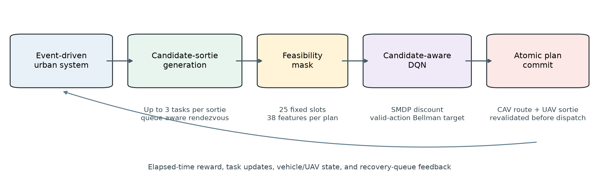
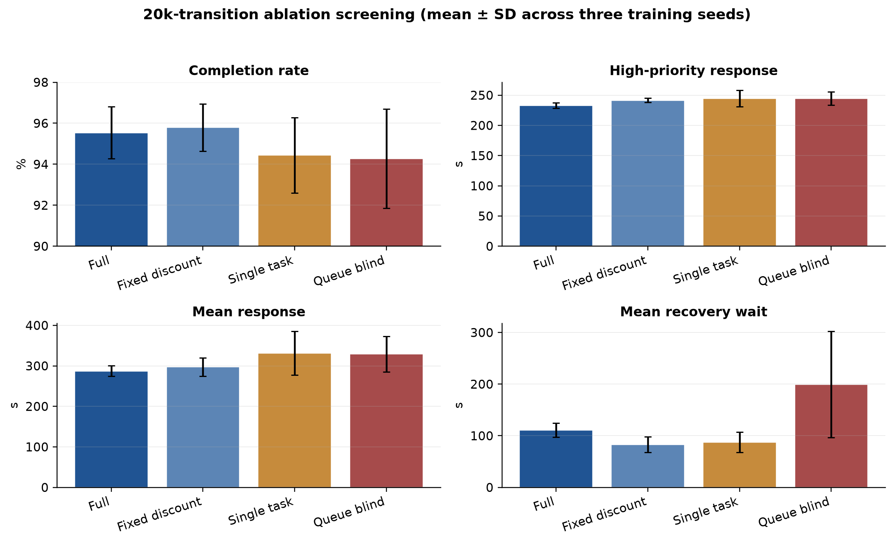
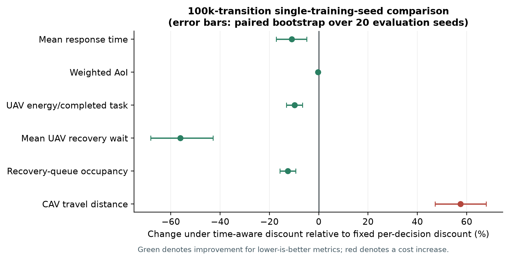

<!--
AUTHOR REVIEW DRAFT — NOT READY FOR SUBMISSION
Target venue: IEEE Transactions on Intelligent Transportation Systems (T-ITS)
Evidence status: 20k-transition ablation screening (3 training seeds) and a 100k-transition
discount comparison (1 training seed). Final multi-seed long-horizon training, heuristic
baselines, cross-network validation, and sensitivity experiments remain provisional.
-->

# Event-Driven Candidate-Sortie Reinforcement Learning for Dynamic CAV-UAV Cooperative Traffic Patrol

Yuxiang Ouyang, Shijia Zhang, Yikang Rui*, and Ran Bin

*Author affiliations, correspondence details, and author order are inherited provisionally from the previous manuscript and must be verified before submission.*

## Abstract

Urban traffic patrol with a connected and automated vehicle (CAV) carrying multiple unmanned aerial vehicles (UAVs) couples stochastic task arrivals, road-constrained ground motion, three-dimensional UAV routing, limited endurance, and synchronized recovery. Direct reinforcement learning over all task sequences, launch decisions, rendezvous choices, and CAV route modifications is computationally impractical and can generate unsafe or infeasible actions. This paper develops an event-driven candidate-sortie reinforcement learning framework that separates constrained short-horizon plan construction from long-horizon policy learning. At each system event, a queue-aware generator constructs feasible joint plans that combine a CAV action with a UAV sortie of up to three tasks and a recovery schedule. The retained plans are mapped to 25 fixed action slots, encoded by 38 plan features, and filtered by a feasibility mask before evaluation by a candidate-aware dueling Double-DQN with NoisyNet exploration and prioritized replay. Because decision intervals are irregular, the Bellman target uses an elapsed-time discount. Experiments use a 333-node directed road network and building-aware three-dimensional UAV paths in Xinjiekou, Nanjing. In a preliminary 20k-transition study with three training seeds, the full framework achieved a 95.54% completion rate and a 232.87 s high-priority response time. Relative to the single-task variant, it reduced mean response time by 44.08 s and UAV energy by 3975 units. Queue awareness reduced mean recovery waiting by 88.65 s relative to queue-blind planning. A separate 100k-transition, single-training-seed comparison associated elapsed-time discounting with a 27.41 s reduction in mean response time and a 47.33 s reduction in recovery waiting, but also with 21.63 km more CAV travel. These results support the candidate-sortie representation while showing that the current evidence is screening-level rather than submission-final.

**Index Terms—** action masking, connected and automated vehicles, event-driven control, reinforcement learning, semi-Markov decision process, traffic patrol, unmanned aerial vehicles.

## I. Introduction

Unmanned aerial vehicles have become practical sensing platforms for traffic observation, incident confirmation, road-safety analysis, and infrastructure inspection [1]. Their mobility can shorten access time to congested or obstructed locations, but endurance, launch and recovery, airspace obstacles, and communication constraints limit sustained urban operation. A connected and automated vehicle can serve as a mobile carrier, computing platform, and recovery station. The combined system therefore joins the long endurance and payload capacity of a ground vehicle with the direct movement and wide field of view of UAVs. The resulting coordination problem is not a conventional vehicle-routing problem. The CAV moves on a directed road graph, the UAVs fly in three-dimensional free space, and every UAV sortie must remain synchronized with a future CAV recovery opportunity.

Traffic patrol also differs from the largely static truck-drone delivery setting surveyed in [2]. Patrol requests are heterogeneous and may be released at irregular times. A routine revisit can tolerate delay, whereas incident confirmation or obstruction inspection has a short deadline and a larger information value. Dispatch decisions change the future positions of the CAV and UAVs, the contents of the recovery queue, the energy available to each UAV, and the set of tasks that can still be completed. A locally attractive launch may create a poor rendezvous, delay other recovering UAVs, or force a CAV detour that reduces later coverage. The policy must therefore optimize coupled service, mobility, energy, and synchronization outcomes over time.

Classical truck-drone studies have established useful routing structures, including the flying-sidekick traveling-salesman problem [3], endurance-aware vehicle routing [4], cooperative coverage [7], and two-echelon arc routing for traffic patrol [5], [6]. These models explicitly represent feasibility but usually solve a known or periodically updated optimization problem. Dynamic extensions address on-demand requests through recourse, approximate dynamic programming, or reinforcement learning [8]–[12]. Their results motivate online control, yet a direct transfer to traffic patrol is difficult because the action at a decision epoch is itself a variable-length combination of task assignment, task order, CAV motion, rendezvous location, and recovery timing.

The central design choice in this study is to expose only structured, feasible high-level plans to the learning policy. A deterministic planner generates a bounded set of candidate sorties and combines them with candidate CAV actions. Each resulting joint plan contains executable ground and aerial routes, recovery information, and predicted resource consequences. A binary action mask removes padded and infeasible alternatives. Reinforcement learning then ranks the retained plans according to their long-term value. This separation preserves explicit operational constraints while avoiding enumeration of the full combinatorial action space.

The controller is event driven. Decisions are requested when tasks arrive, UAV or CAV states change, recovery events occur, or another system event creates a meaningful new choice. The time between consecutive decisions is consequently nonuniform. Treating every transition as an equal-duration step changes the physical meaning of the discount factor: the same per-decision discount would be applied after a few seconds and after several minutes. We instead formulate the learning problem as a semi-Markov decision process (SMDP) and use the elapsed time in the bootstrap discount. SMDPs provide the standard mathematical basis for temporally extended or irregular-duration decisions [20], and recent asynchronous dispatch research shows their relevance to event-triggered transportation control [12].

This paper makes four contributions.

1. It formulates dynamic CAV-UAV traffic patrol as an event-driven SMDP whose high-level actions are complete candidate sorties coupled with CAV motion and recovery decisions.

2. It develops a bounded, queue-aware joint-plan generator with three plan families, a safe fallback, exact pre-dispatch revalidation, and a 38-feature candidate representation. The generator converts a variable-size feasible set into 25 fixed action slots and an explicit validity mask.

3. It introduces a candidate-aware Rainbow-style DQN that combines dueling value decomposition, Double-DQN targets, NoisyNet exploration, prioritized experience replay, and action masking. The implementation does not use a categorical distributional head and is therefore described as Rainbow-style rather than full Rainbow.

4. It reports reproducible preliminary evidence on a 333-node Xinjiekou road network. The analysis separates a three-training-seed 20k-transition ablation screen from a one-training-seed 100k-transition discount comparison and explicitly reports the CAV-distance tradeoff induced by elapsed-time discounting.

The evidence remains incomplete. In particular, the ongoing 1M-transition run has not reached its configured endpoint, and the current result folders do not contain matched heuristic-baseline runs under the repaired training warm-up. The paper therefore does not claim final superiority over classical dispatch methods. The present draft is intended to establish the method, experimental protocol, and defensible preliminary findings before the remaining experiments are completed.

## II. Related Work

### A. UAV-Based Traffic Monitoring and Urban Flight

UAVs support road-user observation, traffic-state estimation, crash investigation, and infrastructure assessment from a viewpoint that is difficult to obtain with fixed cameras [1]. The value of this viewpoint depends on safe and efficient urban flight. Buildings, vertical clearance, and moving obstacles make planar Euclidean distance an incomplete surrogate for flight cost. Liu *et al.* [13] demonstrated the importance of explicitly planning collision-free trajectories in three-dimensional low-altitude urban environments. The present study follows this operational principle by evaluating UAV movement on a building-aware voxel map and reserving exact three-dimensional route materialization for the selected plan.

Most traffic-monitoring studies focus on sensing, perception, or UAV path construction rather than the joint online control of a road vehicle and several recovering UAVs. The closest routing work is the GV-drone arc-routing model of Xu *et al.* [5], which coordinates a ground vehicle and multiple drones for urban traffic patrol, and the two-echelon arc-routing formulation of Cheng *et al.* [6]. Those studies show that traffic patrol has network-service structure distinct from parcel delivery. They also treat coordination largely as an optimization problem over a planned task set. The proposed framework adds stochastic task release, event-triggered replanning, a shared mobile recovery queue, and learned long-horizon ranking of feasible candidate plans.

### B. Vehicle-Drone Routing and Dynamic Coordination

Murray and Chu [3] introduced the flying-sidekick traveling-salesman problem, and Dorling *et al.* [4] incorporated drone endurance and cost into vehicle-routing formulations. Subsequent work expanded the scope to multi-task or multi-visit sorties, mobile rendezvous, and multiple drones. Macrina *et al.* [2] organized this literature around routing structures, synchronization, launch and recovery, and application settings. Cooperative coverage models such as [7] are especially relevant to patrol because a ground vehicle can transport UAVs between regions while UAVs serve dispersed locations.

Dynamic requests change the problem from route construction to sequential control. Gu *et al.* [8] modeled scheduled deliveries and on-demand pickups as an MDP and used a recourse-based solution framework. Cui *et al.* [9] studied randomly arriving requests with en-route synchronization and developed a reinforcement-learning method for request acceptance, resource assignment, and continuous takeoff and landing positions. Chen *et al.* [10] used deep Q-learning for same-day delivery with separate vehicle and drone fleets, showing that action-level information can improve assignment decisions. Li *et al.* [11] further used hierarchical deep reinforcement learning for same-day vehicle-drone delivery. These studies establish the value of sequential learning, but they do not directly resolve the patrol-specific combination of edge-associated tasks, building-aware flight, a shared recovery queue, and CAV rerouting.

The candidate-sortie design is related to action-space decomposition in dynamic routing. Instead of asking a neural network to emit every low-level decision, a combinatorial module proposes executable alternatives and the learned component ranks them. This design can exploit domain constraints, reduce invalid exploration, and retain interpretable action records. Its main risk is candidate omission: no policy can select a plan that the generator failed to retain. Candidate diversity, conservative feasibility checks, and explicit truncation diagnostics are therefore part of the method rather than implementation details.

### C. Deep Reinforcement Learning With Structured and Masked Actions

Deep Q-networks established value-based control with nonlinear function approximation [14]. Double Q-learning reduces maximization bias by separating online action selection from target-network evaluation [15], while dueling architectures separately estimate a state value and action advantages [16]. Prioritized replay emphasizes transitions with larger temporal-difference errors [17], and NoisyNet layers provide learned parametric exploration [18]. Rainbow combined these and other improvements, including distributional learning and multi-step returns, in a unified agent [19]. Our implementation uses Double-DQN selection, a dueling head, prioritized replay, NoisyNet exploration, and one-step SMDP targets. It does not implement the categorical distributional component of Rainbow.

Action masking is essential when the available action set changes with state. Invalid-action masking has been studied most directly for policy-gradient methods [21], but the same principle applies to discrete value-based control: invalid values must be excluded from both behavioral selection and the bootstrap maximum. Masking only at execution time would allow an infeasible action to dominate the target and corrupt learning. The proposed loss therefore masks online next-action selection and uses the corresponding valid action for target-network evaluation.

### D. Event-Driven Dispatch and Research Gap

Fixed decision intervals are convenient but may delay urgent responses and create redundant steps when the system is unchanged. Cordeiro and Pitombeira-Neto [12] formulated asynchronous dynamic vehicle dispatch as an SMDP and coupled discrete-event simulation with Double-DQN agents. That work supports event-triggered transportation control but considers vehicle-request assignment rather than synchronized CAV-UAV sorties. In a mobile-recovery system, an action may occupy a UAV for a variable flight time and alter future CAV commitments. Both the action representation and the elapsed-time discount must therefore reflect physical duration.

The nearest prior studies address, separately, traffic-patrol arc routing [5], [6], dynamic truck-drone requests [8], [9], deep Q-learning with vehicle-drone resources [10], and asynchronous SMDP dispatch [12]. The unresolved intersection is an online, building-aware traffic-patrol controller that constructs feasible multi-task UAV sorties, coordinates them with a moving CAV and recovery queue, and learns over irregular event intervals. This paper addresses that intersection without claiming that the candidate generator is globally complete or that the preliminary experiments establish final statistical superiority.

## III. System Model and Problem Formulation

### A. Urban Patrol System

The road system is a directed graph $G=(V,E)$ with node coordinates, edge lengths, and an admissible speed for the CAV. A single CAV carries a set of UAVs $D=\{1,\ldots,m\}$. The CAV position is restricted to $G$. UAV motion is planned in a three-dimensional voxel representation of the urban environment. Each UAV $d$ has remaining energy $b_d(t)$, flight mode, current route, assigned tasks, and recovery commitment. The CAV state includes its current node, route, target, travel status, and any wait or reroute commitment.

A task $i$ is described by

$$
\tau_i=(\ell_i,r_i,d_i,p_i,s_i,c_i),
$$

where $\ell_i$ is a road segment or mapped service location, $r_i$ is the release time, $d_i$ is the deadline, $p_i$ is priority, $s_i$ is service duration, and $c_i$ is task class. The current implementation includes periodic patrol, incident confirmation, congestion-anomaly scanning, obstruction inspection, and critical-period patrol. A task becomes eligible at $r_i$, is removed when completed, and is recorded as timed out if its deadline expires before completion.

The recovery queue is a time-ordered set of planned UAV-CAV rendezvous operations. Each record stores the UAV, recovery node, predicted arrival times, and schedule version. A newly considered sortie can delay an existing recovery or require CAV waiting. The queue is therefore part of the system state and of candidate evaluation.

### B. Event-Driven Decision Epochs

Let $t_k$ denote the $k$th decision time and $\Delta t_k=t_{k+1}-t_k$. Decision requests arise from task releases, task timeouts, UAV state changes, CAV arrivals, recovery events, and an initial-decision event. Events occurring at the same time are coalesced before a new action is requested, which avoids repeated zero-duration choices from a single physical transition. The simulator also records instantaneous-dispatch and zero-duration diagnostics so that event processing can be audited.

The state $s_k$ contains global system features and a fixed matrix of candidate-plan features. With three UAVs, the global vector has 75 elements: six system-level quantities, three attributes per UAV, and six attributes for each of ten observable task slots. Joint-plan mode appends 25 rows of 38 plan features, producing a 1025-dimensional observation. Slot 0 is the safe plan, and the remaining 24 slots contain non-safe plans or zero padding.

### C. Joint Candidate Plans

At each decision epoch, a high-level action is a joint plan

$$
a_k=(g_k,\sigma_k,\rho_k),
$$

where $g_k$ is a CAV action, $\sigma_k$ is an optional UAV sortie, and $\rho_k$ is a recovery schedule. The ground action belongs to `keep_route`, `wait`, `move_to`, or `reroute`. The generator organizes non-safe plans into three families.

*Type I service plans* launch an available UAV to serve one or more tasks while the CAV follows a compatible ground action. *Type II rendezvous plans* prioritize recovery synchronization and may move or wait the CAV to meet a returning UAV. *Type III reroute plans* change the CAV route when the current route is poorly aligned with task service or recovery. A safe plan is always present and preserves or safely advances the current commitments without starting an infeasible operation.

The number of non-safe slots is fixed at 24. Default quotas reserve up to 12 Type I, eight Type II, and four Type III alternatives. Before quota selection, the ground-candidate pool is truncated to four candidates, at most six sortie combinations are retained per ground candidate, and one insertion alternative is considered per pair. These bounds keep policy inference constant in size. They also define an approximation: a feasible plan outside the retained set is unavailable to the policy.

### D. Feasibility and Objective

A candidate must satisfy resource and synchronization checks before its slot is marked valid. The generator checks UAV availability, energy sufficiency for outbound service and return, connectivity and path existence, the allowed task sequence length, compatibility with current CAV commitments, and recovery feasibility. Exact three-dimensional paths are materialized for the selected plan and revalidated before commit. The state fingerprint and schedule versions are checked to reject a stale cache. Commitment is atomic: either all affected CAV, UAV, task, and queue records are updated, or the simulator rolls back the attempted change.

The control objective balances task completion and priority against timeout, information age, energy, ground travel, recovery congestion, route changes, and operational failures. Let $R_k$ be the reward accumulated over $(t_k,t_{k+1}]$. The policy seeks

$$
\max_\pi \; \mathbb{E}_\pi\!\left[\sum_{k=0}^{K-1}\Gamma_k R_k\right],
$$

where $\Gamma_k$ is the cumulative discount to epoch $k$. The objective is not a shortest-path criterion. It permits a longer CAV route when the route creates earlier UAV recovery, lower information age, or more completed high-priority tasks.

## IV. Candidate-Sortie Reinforcement Learning Framework

### A. Bounded Sortie Generation

The sortie generator first prefilters active tasks for each idle UAV. The default pool contains at most 12 tasks, with an optimized prefilter retaining at most six tasks per UAV for full evaluation. High-priority and urgent tasks are protected from aggressive pruning. The generator enumerates task sequences with a maximum length of three, considers up to three recovery nodes per sequence, and evaluates no more than 100 full combinations per UAV. Connectivity filters, cached distances, cached CAV arrival estimates, duplicate removal, and bounded top-$K$ insertion limit computation without changing the action interface.

For a sequence $q=(i_1,\ldots,i_h)$ and recovery node $v$, the generator estimates flight time, service time, energy, return distance, CAV arrival, UAV arrival, and the effect of inserting the recovery into the current queue. A pre-score combines service benefit with travel, energy, delay, and detour terms. This score is used only to retain a diverse bounded candidate set. The learned policy determines the final action. Diversity limits prevent a large number of variants with the same first task from occupying all top-$K$ positions.

### B. Queue-Aware Joint-Plan Features

Each joint plan is represented by 38 normalized features. The schema contains eight groups: (1) task count, priority, urgency, slack, and predicted information-age reduction, (2) sortie duration and outbound energy, (3) return distance, time, energy, and battery slack, (4) CAV travel, wait, detour, and route-switch information, (5) recovery waiting, existing-queue delay, insertion cost, and hover energy, (6) rendezvous and minimum recovery slack, (7) queue length, locked prefix, UAV availability, and pending-task counts, and (8) event, dispatch, safe-plan, and plan-family indicators. Distance, time, energy, and task-count features use scales of 3600 m, 600 s, 1800 energy units, and 10 tasks, respectively, followed by clipping to $[-5,5]$.

Queue-blind ablation removes the recovery-wait, CAV-wait, existing-queue-delay, insertion-cost, and queue-length signals used by the full generator. This ablation does not merely remove a descriptive state variable. It tests whether candidate construction that reasons about shared recovery capacity prevents future blocking.

### C. Action Mask and Candidate-Aware Value Network

Let $M_k\in\{0,1\}^{25}$ be the action mask. The safe plan has $M_{k,0}=1$. A non-safe slot is valid only if it contains a generated plan that passed feasibility checks. Padded slots have mask value zero. Behavioral selection is

$$
a_k=\arg\max_{a:M_{k,a}=1} Q_\theta(s_k,a).
$$

The same mask is used inside the Bellman target. Invalid values are replaced by a large negative constant before `argmax`. The environment still validates the selected slot at commit time.

The network separates global and candidate processing. A two-layer global encoder maps the global portion of the observation to a 256-dimensional embedding. A two-layer candidate encoder maps each 38-dimensional non-safe plan vector to a 128-dimensional embedding. The shared global representation is concatenated with each candidate embedding. A dueling head estimates a state value and per-action advantages. Advantage centering is computed over valid actions only, preventing padded slots from changing the value scale. Separate NoisyLinear heads score the safe action and non-safe candidates.

### D. Elapsed-Time SMDP Target

For a reference interval $\bar{\Delta}=60$ s and configured $\gamma=0.99$, the transition discount is

$$
\gamma_k=\gamma^{\Delta t_k/\bar{\Delta}}.
$$

The one-step Double-DQN target is

$$
y_k=R_k+(1-z_k)\gamma_k Q_{\bar\theta}\!\left(s_{k+1},
\arg\max_{a:M_{k+1,a}=1}Q_\theta(s_{k+1},a)\right),
$$

where $z_k$ is the complete terminal indicator, $\theta$ is the online parameter vector, and $\bar\theta$ is the target parameter vector. The fixed-discount ablation replaces $\gamma_k$ with $\gamma$ for every decision, regardless of elapsed time. Both variants retain event-driven decision epochs. Only the discount changes.

The loss is the importance-weighted Huber loss over prioritized replay samples. Replay priority uses the absolute temporal-difference error with exponent $\alpha=0.6$. The importance-sampling exponent increases linearly from 0.4 to 1.0 over 200k steps. The replay buffer contains 100,000 transitions, the batch size is 128, Adam uses a learning rate of $10^{-4}$, gradients are clipped at 10, and the target network is updated every 2000 transitions. During the first 1000 transitions, actions are sampled uniformly from valid slots. After this warm-up, the Rainbow-style agent uses NoisyNet exploration without epsilon-greedy noise. This repaired warm-up is important because an untrained candidate-aware network can otherwise fill the initial replay window with the safe action.

**Fig. 1.** Event-driven candidate-sortie control loop. Constrained planning creates executable alternatives, and the learned policy ranks them and receives elapsed-time feedback.

### E. Reward Accounting

The stage-five coordinated reward is computed as an interval increment so that every physical cost is charged once between decision epochs. Positive terms reward completed tasks and their priorities. Cost terms account for timed-out tasks and timeout priority, weighted information age, flight and hover energy, UAV return distance, CAV travel, recovery waiting, recovery-queue occupancy, route changes, route reversal, coordination failure, and illegal action. The principal weights are 30 for completion and timeout, 2 for completion and timeout priority, 0.02 for information age, 0.003 for flight and hover energy, 1.0 for normalized return distance, 0.4 for normalized CAV distance, 0.25 for recovery waiting, and 0.12 for recovery-queue occupancy. Route change and reversal carry weights of 0.15 and 0.50. Coordination failure and illegal action each carry a weight of 30.

Reward components are written to a ledger and checked for conservation against the scalar reward. This accounting supports diagnosis of policy changes: an increased return can be traced to task service, lower delay, lower energy, or a shift of cost from UAV motion to CAV motion. It also prevents the reward alone from being treated as the primary transportation performance measure.

## V. Experimental Design

### A. Xinjiekou Urban Scenario

The main scenario uses a directed road network in Xinjiekou, Nanjing, with 333 nodes and 601 stored directed edges. The CAV travels at 8.3 m/s. Three UAVs are carried by the CAV. Each has a nominal energy capacity of 1800 units and a cruise speed of 10 m/s. The UAV flight model separates climb, cruise, descent, service, and hover phases. Cruise altitude is 60 m, while launch, recovery, and default observation altitude are 20 m.

Building geometry is rasterized into a three-dimensional voxel map. Horizontal voxel size is 10 m and vertical resolution is 20 m, with operational altitude bounded between 20 and 120 m. A 26-neighbor weighted A* search prevents corner cutting and uses road-clearance voxels where available. Exact route planning is performed for a selected sortie, and its feasibility is checked again before commit. Candidate evaluation uses cached approximate distance and time estimates to avoid running the full voxel search for every discarded candidate.

The road and building representation is illustrated in Fig. 2. Launch and recovery nodes are matched to road-network nodes within 5 m. Fig. 3 shows a policy rollout for evaluation seed 1000. The figure is descriptive rather than a causal comparison. It verifies that the logged CAV and UAV trajectories occupy the expected urban domain and that multiple UAVs are dispatched across the episode.

**Fig. 2.** Xinjiekou directed road network, launch/recovery nodes, and building-height layer used by the simulator.

**Fig. 3.** Example two-dimensional projection of the trained-policy rollout for evaluation seed 1000. UAV paths are planned in three dimensions and projected for readability.

### B. Traffic-Patrol Demand

Task releases span 10,800 s, followed by a drain phase of at most 1800 s so that late tasks can be completed or timed out. Periodic patrol uses ten selected road segments, a batch size of two, a 1800 s revisit interval, six cycles, priority 2, and a 1800 s deadline. Incident-confirmation tasks follow a homogeneous Poisson process with rate 2/h, priority 10, and a 420 s deadline. Congestion-anomaly scans use 12 fixed-count random releases concentrated in the middle hour, with priority 6 and a 600 s deadline. Obstruction inspections follow a Poisson process with rate 2/h, priority 8, a 300 s deadline, and 35 s of service. Critical-period patrol is released at 900, 4500, and 8100 s with priority 6 and a 360 s deadline.

This mixture creates recurring coverage obligations and urgent stochastic incidents. Priorities are used by candidate ranking, state features, reward accounting, and the high-priority response metric. The arrival seeds determine the task instances used for evaluation. All variants in a paired comparison use the same evaluation seeds.

### C. Preliminary Experiment Sets

Two experiment sets are available in the current workspace. They answer different questions and are not pooled.

The first is a repaired 20k-transition ablation screen. Four variants were trained with seeds 0, 1, and 2. Each trained policy was evaluated on seeds 1000–1019, giving 60 evaluation episodes per variant. The variants were:

* **Full:** multi-task candidate sorties, queue-aware recovery features and planning, and elapsed-time discounting.
* **Fixed discount:** identical to Full except that every transition uses a fixed per-decision discount of 0.99.
* **Single task:** sortie length is restricted to one task while the remaining framework is retained.
* **Queue blind:** recovery-queue-dependent candidate signals are disabled.

The second set compares elapsed-time and fixed per-decision discounting after 100k transitions. Both runs use training seed 0 and are evaluated on the same 20 evaluation seeds. These runs provide a longer-training view of the discount mechanism but do not quantify training-seed uncertainty.

The current 1M-transition experiment is incomplete at 625k transitions and is excluded from all tables. An unmasked diagnostic configuration exists, but a matched completed result is not available in the repaired ablation folder. Likewise, the current result set does not contain completed heuristic baselines under the same simulator and reward configuration. These gaps are listed as required experiments rather than being filled with results from the previous manuscript.

### D. Performance Measures and Statistical Reporting

Primary service measures are completion rate, timeout rate, high-priority response time, mean response time, and weighted age of information (AoI). Resource and coordination measures include UAV energy, energy per completed task, CAV travel distance, UAV return distance, mean recovery waiting, recovery-queue occupancy, tasks per sortie, path-planning failures, illegal actions, commit failures, and mean candidate-generation time.

For the 20k screen, the mean and standard deviation across three training seeds are reported, with each seed first averaged over its 20 paired evaluation episodes. Paired differences use the same training and evaluation seeds. Bootstrap confidence intervals and paired tests are descriptive because $n=3$ training seeds cannot support precise inference. Holm adjustment is applied within the prespecified primary-metric family. For the 100k comparison, paired bootstrap intervals resample the 20 evaluation seeds. These intervals describe scenario variation conditional on one trained policy per variant. They do not include training randomness.

### E. Reproducibility and Software Checks

The canonical configuration, feature schema, action-mask logic, transition discounts, reward ledger, checkpoint metadata, and raw evaluation files are stored in the project. The checkpoint records observation dimension, action dimension, candidate dimension, decision mode, reward metadata, and replay configuration, and resume validation rejects mismatches. At the time of this draft, the complete local test suite contains 49 passing tests. The tests cover task generation, event coalescing, core ablations, route-change reward accounting, scene setup, and elapsed-time SMDP discounting.

Table I summarizes the principal configuration. The values are the current code defaults rather than values inherited from the prior manuscript.

**TABLE I  Principal Experimental Configuration**

| Component | Setting |
|---|---|
| Road network | Xinjiekou; 333 nodes; 601 stored directed edges |
| Fleet | 1 CAV and 3 UAVs |
| Speeds | CAV 8.3 m/s; UAV cruise 10 m/s |
| UAV energy | 1800 units per UAV |
| 3-D path planning | 10 m horizontal voxels; 20 m vertical voxels; 20–120 m altitude; 26-neighbor weighted A* |
| Decision mode | Event-driven joint plans |
| Action space | 25 slots: 1 safe + 24 non-safe |
| Observation | 1025 dimensions; 38 features per plan |
| Sortie limits | Up to 3 tasks; top 12 sorties per UAV before joint-plan truncation |
| RL algorithm | Candidate-aware dueling Double-DQN, NoisyNet heads, prioritized replay |
| Discount | $0.99^{\Delta t/60}$ for Full; 0.99 per decision for fixed ablation |
| Optimizer | Adam, learning rate $10^{-4}$, batch 128, replay 100,000 |
| Warm-up/target update | 1000 uniform valid-action steps; target update every 2000 steps |
| Evaluation | Seeds 1000–1019 |

## VI. Results

### A. 20k-Transition Ablation Screen

Table II reports the ablation means. The Full policy completed 95.54% of released tasks and timed out 4.46%. The fixed-discount variant had a slightly higher mean completion rate, 95.80%, but a slower high-priority response, 241.61 s compared with 232.87 s. The small completion-rate difference was not resolved across training seeds. Full and fixed discount should therefore be viewed as different early-training tradeoffs, not as a clean ranking on every metric.

Restricting each sortie to one task reduced completion to 94.44% and increased mean response time from 287.45 to 331.53 s. It also raised UAV energy from 20,310 to 24,285 units and CAV distance from 61.34 to 78.04 km. The full policy completed an average of 1.726 tasks per sortie, whereas the single-task variant was fixed at 1. These changes are consistent with the intended mechanism: a multi-task sortie amortizes launch, outbound, and recovery travel over several services and can reduce repeated CAV repositioning. The screening evidence does not prove that every multi-task candidate is beneficial, but it shows that removing the capability changed both service and resource outcomes in the expected direction.

Queue-blind planning achieved a 94.28% completion rate and a 328.97 s mean response time. Its mean UAV recovery waiting was 199.50 s, compared with 110.86 s under Full. CAV distance increased from 61.34 to 75.71 km. The queue-blind variant used fewer measured milliseconds for candidate generation because it evaluated less recovery information, yet its longer recovery waiting indicates that the omitted computation represented an operationally meaningful constraint. The full generator required 2.96 ms on average, which remains small relative to the physical event intervals in this simulator.

**TABLE II  20k-Transition Ablation Screening Results**

| Metric | Full | Fixed discount | Single task | Queue blind |
|---|---:|---:|---:|---:|
| Completion rate (%) | 95.54 | 95.80 | 94.44 | 94.28 |
| Timeout rate (%) | 4.46 | 4.20 | 5.56 | 5.72 |
| High-priority response (s) | 232.87 | 241.61 | 244.79 | 244.60 |
| Mean response (s) | 287.45 | 297.16 | 331.53 | 328.97 |
| Weighted AoI | 2110.88 | 2107.77 | 2124.70 | 2129.65 |
| UAV energy (units) | 20,310 | 19,276 | 24,285 | 20,979 |
| CAV distance (km) | 61.34 | 63.63 | 78.04 | 75.71 |
| Tasks per sortie | 1.726 | 1.791 | 1.000 | 1.828 |
| Mean recovery wait (s) | 110.86 | 83.02 | 87.17 | 199.50 |
| Queue occupancy (s) | 22,708 | 21,147 | 27,305 | 24,559 |
| Mean plan generation (ms) | 2.96 | 3.16 | 3.19 | 1.69 |

*Values are means over three trained policies and 20 evaluation seeds per policy. The experiment is a short-budget screen, not the final convergence study.*

**Fig. 4.** Selected ablation metrics. Error bars are standard deviations of the training-seed means ($n=3$), not standard errors over 60 independent trained agents.

Paired training-seed differences quantify the direction and uncertainty of these effects. Relative to single-task planning, Full reduced mean response time by 44.08 s (95% bootstrap interval 2.49–85.37 s), UAV energy by 3975 units (3367–4563), and CAV distance by 16.69 km (4.57–25.51 km). Full also improved high-priority response by 11.92 s (2.41–21.05 s) and weighted AoI by 13.83 units (2.45–26.48). Completion-rate and timeout-rate intervals crossed zero.

Relative to queue-blind planning, Full reduced mean response time by 41.52 s (13.21–94.38 s) and CAV distance by 14.37 km (5.73–22.57 km). Mean recovery waiting decreased by 88.65 s, with an interval of 12.82–221.21 s. The completion, timeout, high-priority-response, and weighted-AoI intervals crossed zero. Queue-blind plans had shorter generation time by 1.27 ms, which is the expected computational benefit of omitting queue evaluation.

The only primary-metric comparison with a Holm-adjusted paired $p$ value below 0.05 was the high-priority response difference between Full and fixed discount (8.74 s in favor of Full, adjusted $p=0.0222$). This value is based on three training seeds and should not be treated as confirmatory. The large effect-size estimate reflects low between-seed dispersion in this particular screen and can be unstable at $n=3$.

### B. 100k-Transition Discount Comparison

The longer discount comparison produced a clearer conditional difference, but only one training seed was available per mode. Table III shows that elapsed-time discounting reduced mean response time from 250.47 to 223.06 s, a paired change of $-27.41$ s with a 95% evaluation-seed bootstrap interval of $[-43.17,-12.29]$ s. Weighted AoI decreased by 6.63 units $[-10.58,-3.03]$. UAV energy decreased by 1814 units, and energy per completed task decreased by 28.73 units. Mean recovery waiting decreased by 47.33 s, while recovery-queue occupancy decreased by 2612 s.

The improvements were accompanied by substantially more CAV movement. Mean CAV distance increased from 37.65 to 59.29 km, a paired increase of 21.63 km $[17.75,25.54]$. UAV return distance fell by 11.73 km, suggesting a redistribution of mobility from aerial return legs and waiting to ground repositioning. The current reward weights allow that substitution when shorter UAV recovery and response offset the CAV-distance charge. This is a system tradeoff, not a uniformly better outcome.

Completion increased by only 0.16 percentage point and timeout decreased by the same amount. Both intervals crossed zero. High-priority response improved by 4.00 s, but its interval also crossed zero. Consequently, the 100k evidence supports conditional improvements in average response, AoI, UAV energy, and recovery congestion, while leaving completion and priority-specific response unresolved.

**TABLE III  100k-Transition Fixed Versus Elapsed-Time Discount**

| Metric | Fixed per decision | Elapsed-time | Difference (time-aware − fixed), 95% paired CI |
|---|---:|---:|---:|
| Completion rate (%) | 98.22 | 98.38 | +0.16 pp $[-0.51,+0.88]$ |
| Timeout rate (%) | 1.78 | 1.62 | −0.16 pp $[-0.87,+0.54]$ |
| Mean response (s) | 250.47 | 223.06 | −27.41 $[-43.17,-12.29]$ |
| High-priority response (s) | 212.23 | 208.23 | −4.00 $[-19.06,+10.53]$ |
| Weighted AoI | 2078.59 | 2071.96 | −6.63 $[-10.58,-3.03]$ |
| UAV energy (units) | 18,932 | 17,118 | −1814 $[-2374,-1282]$ |
| UAV energy/completed task | 291.98 | 263.25 | −28.73 $[-38.38,-19.21]$ |
| CAV distance (km) | 37.65 | 59.29 | +21.63 $[+17.75,+25.54]$ |
| UAV return distance (km) | 37.91 | 26.18 | −11.73 $[-15.36,-8.14]$ |
| Mean recovery wait (s) | 84.39 | 37.05 | −47.33 $[-57.49,-36.17]$ |
| Queue occupancy (s) | 20,899 | 18,287 | −2612 $[-3283,-1957]$ |

*Confidence intervals resample 20 paired evaluation seeds conditional on one training seed per mode. They do not represent training-seed uncertainty.*

**Fig. 5.** Relative changes under elapsed-time discounting after 100k transitions. Lower is better for all plotted metrics. The reduction in UAV-side costs is accompanied by more CAV travel.

### C. Operational Validity and Runtime

No illegal actions or atomic commit failures were recorded in the reported 20k ablation evaluations. The 100k comparison also recorded zero illegal actions, zero commit failures, and zero infeasible recoveries. These outcomes show that the mask, cache validation, and commit guards were internally consistent for the evaluated episodes. They do not prove safety beyond the modeled constraints. Unmodeled wind, communication loss, moving-aircraft conflict, or map error could invalidate a route that is feasible in the simulator.

The full candidate generator required 2.96 ms on average in the short-budget evaluation. Exact selected-sortie path planning has a separate planning budget and is not represented by this number. The architecture is intended to spend modest time on many approximate candidates and more time only on the action selected for execution. A final real-time claim will require end-to-end latency quantiles on the deployment hardware, including event processing, candidate construction, network inference, exact voxel planning, and atomic commit.

### D. Result Status

The evidence supports three limited statements. First, multi-task candidate sorties changed service and resource performance in a favorable direction relative to a single-task restriction under the 20k screen. Second, queue-aware planning substantially reduced recovery waiting relative to a queue-blind generator. Third, elapsed-time discounting changed the learned mobility allocation and reduced several UAV-side delays and costs in the single-seed 100k comparison. The evidence does not yet support a claim of convergence, cross-network generalization, superiority over heuristic dispatch, or statistical significance across long-training random seeds.

## VII. Discussion

### A. Why the Candidate-Sortie Representation Matters

The main contribution is the action representation rather than a novel neural-network component. A raw action would have to choose a UAV, select and order a variable number of tasks, choose a recovery node, schedule the recovery among other UAVs, and possibly modify the CAV route. The number of combinations changes whenever a task or vehicle state changes. Candidate generation performs this combinatorial reasoning with explicit constraints, while the value network evaluates delayed consequences. This decomposition is well matched to safety-constrained transportation systems because operational rules remain inspectable and testable.

The representation also explains why action masking is more than an exploration convenience. The validity of a joint plan depends on energy, path connectivity, resource status, schedule versions, and the current recovery queue. Allowing infeasible actions into the bootstrap maximum would teach the network from values that cannot be executed. Applying the mask to behavior, online next-action selection, and target evaluation keeps the Bellman update aligned with the available plan set.

Candidate construction nonetheless introduces approximation bias. The default system can retain only 24 non-safe plans, and prefiltering may discard an action whose immediate score is poor but long-term value is high. Fixed family quotas can also be inefficient when one decision epoch needs mostly recovery actions and another needs mostly task-service actions. Future work should learn adaptive quotas, uncertainty-aware candidate expansion, or a second-stage local search around high-value plans. Candidate-recall diagnostics against a larger offline pool would help quantify what the bounded generator omits.

### B. Multi-Task Sorties and Recovery Congestion

The single-task ablation isolates the operational value of serving several nearby tasks within one launch-recovery cycle. The full framework reduced average response, energy, and CAV distance while averaging 1.726 tasks per sortie. These changes suggest that multi-task service avoids repeated outbound and return legs and reduces the number of CAV relocations required to support the same demand. The completion-rate interval crossed zero, so the strongest evidence concerns efficiency and delay rather than the proportion of tasks completed.

Recovery coordination creates a different mechanism. The queue-blind variant generated plans faster but imposed much longer UAV recovery waiting. An individually feasible sortie can still be systemically poor when several UAVs return to incompatible locations or times. Queue features expose the locked prefix, insertion delay, hover cost, CAV waiting, and rendezvous slack to both the generator and the value network. The large waiting-time difference indicates that the shared recovery station is a binding resource even with only three UAVs.

The comparison also warns against using one metric in isolation. Queue-blind planning had much shorter UAV return distance than Full, yet longer waiting and more CAV travel. A short recorded return route can reflect early or conservative recovery behavior rather than efficient task service. Completion, response, energy, ground travel, aerial return, and queue congestion should be interpreted jointly.

### C. Meaning of Elapsed-Time Discounting

In an event-driven controller, a transition may represent a short state update or a long period of travel and service. A fixed per-decision discount treats these transitions as equally distant in time and can overvalue or undervalue delayed outcomes depending on event density. Elapsed-time discounting restores a consistent time preference by raising the reference discount to the fraction of a 60 s interval.

The 100k comparison shows that this modeling change can alter physical behavior. The time-aware policy used more CAV distance but less UAV energy, return distance, recovery waiting, and queue occupancy. One interpretation is that the policy learned to reposition the CAV more aggressively to create better recovery opportunities. That explanation is consistent with the observed metrics, but the current experiment cannot establish the causal internal mechanism. Policy-log analysis should test whether the additional ground travel occurs before congested recovery periods, whether it changes Type II and Type III plan frequencies, and whether it is concentrated around urgent tasks.

The 20k and 100k studies do not yield identical rankings on all outcomes. At 20k, fixed discount had slightly better mean completion and AoI, although Full had faster high-priority response. At 100k, elapsed-time discount had better mean response and AoI conditional on one training seed. This difference reinforces the need for long-training multi-seed evaluation. Short-budget ablations identify promising mechanisms but can confound learning speed with asymptotic policy quality.

### D. Implications for Intelligent Transportation Systems

The proposed architecture is relevant when an intelligent transportation controller must combine learned ranking with hard operational logic. Traffic-patrol agencies may require auditable reasons for rejecting a route, deterministic fallback behavior, and assurance that a neural policy cannot select padded or energy-infeasible actions. Candidate plans provide explicit task lists, predicted timings, routes, and recovery schedules that can be logged and reviewed.

The framework also separates computation by timescale. Fast approximate estimation screens many alternatives. Exact three-dimensional path planning is reserved for the selected sortie. Event-driven decisions avoid unnecessary fixed-interval inference when no meaningful choice exists. These properties can support real-time implementation, but deployment would require bounded worst-case latency, verified maps, communication-loss behavior, dynamic geofencing, and conflict management with other low-altitude traffic.

### E. Limitations and Required Experiments

The current simulator assumes one CAV, three UAVs, deterministic nominal speeds, zero launch time, zero recovery time, and instantaneous battery replacement. Wind, precipitation, communication failure, stochastic road travel time, moving aerial obstacles, low-level multi-UAV deconfliction, and physical docking failure are not modeled. The road network and building layer represent one urban area. These assumptions restrict both external validity and the interpretation of zero infeasible recoveries.

The statistical evidence is also incomplete. Three 20k training seeds are suitable for screening but not for a final T-ITS claim. The 100k discount comparison uses one training seed. The unfinished 1M run is excluded. The final study should train at least three, preferably five, independent long-budget policies for each principal method, retain the same evaluation scenarios, report seed-level paired intervals, and include learning curves and convergence diagnostics.

Four comparison groups are required before submission. First, heuristic baselines should include priority-first greedy dispatch, nearest-feasible task dispatch, and a queue-aware insertion heuristic under the identical simulator. Second, an unmasked diagnostic should quantify illegal-action frequency and learning instability, with environmental guards retained for safety. Third, cross-network evaluation should use the Baijiahu scene or another road network with a different node density and edge-length distribution. Fourth, sensitivity experiments should vary task intensity, UAV count, energy capacity, recovery time, and candidate budget. Results from the prior manuscript should not be copied into these tables unless they are regenerated with the current code and configuration.

Reward sensitivity is another concern. The time-aware policy traded 21.63 km of additional CAV travel for lower UAV-side cost and delay. Different agencies may value ground mileage, response time, energy, and information freshness differently. A Pareto analysis or constrained formulation would communicate this tradeoff more transparently than a single scalar reward. The final paper should include at least one alternative weight profile and report whether the qualitative mechanisms persist.

## VIII. Conclusions

This paper presented an event-driven candidate-sortie reinforcement learning framework for dynamic CAV-UAV traffic patrol. A bounded queue-aware planner constructs executable combinations of CAV motion, multi-task UAV service, and recovery scheduling. The retained alternatives are represented by fixed action slots and candidate features, filtered by a feasibility mask, and ranked by a candidate-aware Rainbow-style DQN. An SMDP target discounts each transition according to elapsed physical time.

Preliminary experiments indicate that the representation captures meaningful operational mechanisms. Multi-task sorties reduced mean response, UAV energy, and CAV travel relative to a single-task restriction in a three-seed 20k screen. Queue-aware planning reduced UAV recovery waiting relative to queue-blind planning. In a separate one-seed 100k comparison, elapsed-time discounting reduced response, UAV energy, and recovery congestion, while increasing CAV travel. The latter tradeoff shows why joint transportation and UAV metrics are necessary.

The current draft does not make a final performance-superiority claim. Long-budget multi-seed training, matched heuristic baselines, cross-network validation, action-mask diagnostics, and resource sensitivity remain to be completed. Once those experiments are available, the framework can be evaluated as a deployable decision architecture rather than only as a validated simulation prototype.

## Acknowledgment

This research was supported by the National Key Research and Development Program of China (Grant No. 2024YFB4303102). *[AUTHOR TO VERIFY funding wording and grant attribution.]*

## Author Contributions

Study conception and design: Y. Ouyang and Y. Rui. Data processing: Y. Ouyang and S. Zhang. Analysis and interpretation: Y. Ouyang, Y. Rui, and B. Ran. Draft preparation: Y. Ouyang and S. Zhang. All authors reviewed the results and approved the submitted version. *[AUTHOR TO VERIFY against the final CRediT statement.]*

## Data and Code Availability

The current research code, configurations, feature schema, trained checkpoints, and raw evaluation outputs are maintained in the project repository. *[AUTHOR TO ADD an archival repository URL and release identifier before submission.]*

## Declaration of Competing Interest

The authors declare no known competing financial interests or personal relationships that could have influenced the work reported in this paper. *[AUTHOR TO VERIFY.]*

## References

[1] F. Outay, H. A. Mengash, and M. Adnan, “Applications of unmanned aerial vehicle (UAV) in road safety, traffic and highway infrastructure management: Recent advances and challenges,” *Transportation Research Part A: Policy and Practice*, vol. 141, pp. 116–129, 2020, doi: 10.1016/j.tra.2020.09.018.

[2] G. Macrina, L. Di Puglia Pugliese, F. Guerriero, and G. Laporte, “Drone-aided routing: A literature review,” *Transportation Research Part C: Emerging Technologies*, vol. 120, Art. no. 102762, 2020, doi: 10.1016/j.trc.2020.102762.

[3] C. C. Murray and A. G. Chu, “The flying sidekick traveling salesman problem: Optimization of drone-assisted parcel delivery,” *Transportation Research Part C: Emerging Technologies*, vol. 54, pp. 86–109, 2015, doi: 10.1016/j.trc.2015.03.005.

[4] K. Dorling, J. Heinrichs, G. G. Messier, and S. Magierowski, “Vehicle routing problems for drone delivery,” *IEEE Transactions on Systems, Man, and Cybernetics: Systems*, vol. 47, no. 1, pp. 70–85, 2017, doi: 10.1109/TSMC.2016.2582745.

[5] B. Xu, K. Zhao, Q. Luo, G. Wu, and W. Pedrycz, “A GV-drone arc routing approach for urban traffic patrol by coordinating a ground vehicle and multiple drones,” *Swarm and Evolutionary Computation*, vol. 77, Art. no. 101246, 2023, doi: 10.1016/j.swevo.2023.101246.

[6] J. Cheng, T. Liao, G. Wu, Z. Ma, and J. Shi, “Two-echelon arc routing problem with drones in traffic patrol,” *IEEE Transactions on Automation Science and Engineering*, vol. 22, pp. 17170–17188, 2025, doi: 10.1109/TASE.2025.3575171.

[7] Y. Xia, C. Chen, Y. Liu, J. Shi, and Z. Liu, “Two-layer path planning for multi-area coverage by a cooperative ground vehicle and drone system,” *Expert Systems with Applications*, vol. 217, Art. no. 119604, 2023, doi: 10.1016/j.eswa.2023.119604.

[8] R. Gu, Y. Liu, and M. Poon, “Dynamic truck–drone routing problem for scheduled deliveries and on-demand pickups with time-related constraints,” *Transportation Research Part C: Emerging Technologies*, vol. 151, Art. no. 104139, 2023, doi: 10.1016/j.trc.2023.104139.

[9] H. Cui, K. Li, S. Jia, and Q. Meng, “Dynamic collaborative truck-drone delivery with en-route synchronization and random requests,” *Transportation Research Part E: Logistics and Transportation Review*, vol. 192, Art. no. 103802, 2024, doi: 10.1016/j.tre.2024.103802.

[10] X. Chen, M. W. Ulmer, and B. W. Thomas, “Deep Q-learning for same-day delivery with vehicles and drones,” *European Journal of Operational Research*, vol. 298, no. 3, pp. 939–952, 2022, doi: 10.1016/j.ejor.2021.06.021.

[11] M. Li, K. Cai, and P. Zhao, “Optimizing same-day delivery with vehicles and drones: A hierarchical deep reinforcement learning approach,” *Transportation Research Part E: Logistics and Transportation Review*, vol. 193, Art. no. 103878, 2025, doi: 10.1016/j.tre.2024.103878.

[12] F. E. A. Cordeiro and A. R. Pitombeira-Neto, “A deep reinforcement learning approach for the asynchronous dynamic vehicle dispatching problem,” *Artificial Intelligence for Transportation*, vols. 3–4, Art. no. 100038, 2025, doi: 10.1016/j.ait.2025.100038.

[13] H. Liu, G. Wu, L. Zhou, W. Pedrycz, and P. N. Suganthan, “Tangent-based path planning for UAV in a 3-D low altitude urban environment,” *IEEE Transactions on Intelligent Transportation Systems*, vol. 24, no. 11, pp. 12062–12077, 2023, doi: 10.1109/TITS.2023.3285568.

[14] V. Mnih *et al.*, “Human-level control through deep reinforcement learning,” *Nature*, vol. 518, pp. 529–533, 2015, doi: 10.1038/nature14236.

[15] H. van Hasselt, A. Guez, and D. Silver, “Deep reinforcement learning with Double Q-learning,” in *Proc. 30th AAAI Conf. Artificial Intelligence*, 2016, pp. 2094–2100, doi: 10.1609/aaai.v30i1.10295.

[16] Z. Wang, T. Schaul, M. Hessel, H. van Hasselt, M. Lanctot, and N. de Freitas, “Dueling network architectures for deep reinforcement learning,” in *Proc. 33rd Int. Conf. Machine Learning*, vol. 48, 2016, pp. 1995–2003.

[17] T. Schaul, J. Quan, I. Antonoglou, and D. Silver, “Prioritized experience replay,” in *Proc. Int. Conf. Learning Representations*, 2016, arXiv:1511.05952.

[18] M. Fortunato *et al.*, “Noisy networks for exploration,” in *Proc. Int. Conf. Learning Representations*, 2018, arXiv:1706.10295.

[19] M. Hessel *et al.*, “Rainbow: Combining improvements in deep reinforcement learning,” in *Proc. 32nd AAAI Conf. Artificial Intelligence*, 2018, doi: 10.1609/aaai.v32i1.11796.

[20] R. S. Sutton, D. Precup, and S. Singh, “Between MDPs and semi-MDPs: A framework for temporal abstraction in reinforcement learning,” *Artificial Intelligence*, vol. 112, nos. 1–2, pp. 181–211, 1999, doi: 10.1016/S0004-3702(99)00052-1.

[21] S. Huang and S. Ontañón, “A closer look at invalid action masking in policy gradient algorithms,” arXiv:2006.14171, 2020.

---

## Author-Only Chinese Abstract (Not for Submission)

城市交通事件巡查中的车机协同同时受到动态任务到达、地面道路约束、无人机三维航迹、续航能力以及移动回收同步的影响。若直接让强化学习策略组合任务序列、起降位置、车辆改道和回收顺序，动作空间会迅速膨胀，并可能产生不可执行方案。本文提出一种事件驱动的候选架次强化学习框架：系统状态发生有效变化时，由队列感知的规划器构造包含车辆动作、最多三个任务的无人机架次及回收计划的联合候选；候选被映射到25个固定动作槽，以38维特征编码，并在候选感知的双流Double-DQN评估前应用可行性掩码。针对不规则决策间隔，Bellman目标采用基于实际经过时间的半马尔可夫折扣。新街口场景包含333个道路节点、三维建筑体素地图、1辆CAV和3架UAV。初步的三训练种子、2万步消融结果表明，完整方法的任务完成率为95.54%，高优先级任务响应时间为232.87 s；与单任务架次相比，平均响应时间减少44.08 s、无人机能耗减少3975单位；与忽略回收队列的规划相比，平均回收等待减少88.65 s。另一个单训练种子、10万步比较中，时间感知折扣使平均响应时间减少27.41 s、回收等待减少47.33 s，但CAV行驶距离增加21.63 km。现有证据仍属于筛选和机制验证阶段，最终投稿前需补充长训练多随机种子、启发式基线、跨路网验证和敏感性分析。

**作者核对关键词：** 车机协同；事件驱动控制；动作掩码；半马尔可夫决策过程；交通巡查；无人机调度。

## Author Checklist Before T-ITS Submission

- [ ] Complete at least three, preferably five, long-budget training seeds for Full and all principal baselines.
- [ ] Add matched heuristic and unmasked diagnostic results produced by the repaired code.
- [ ] Add cross-network validation and demand/fleet/energy/candidate-budget sensitivity.
- [ ] Replace provisional author affiliations, correspondence, contributions, funding, and data-availability text.
- [ ] Decide whether the CAV-distance increase under elapsed-time discounting is acceptable or requires a constrained/Pareto formulation.
- [ ] Archive code and raw results with a persistent identifier and add it to the data and code statement.
- [ ] Reformat in the official IEEE journal template and recheck the final page count.
- [ ] Run iThenticate or the institution’s approved similarity check against the prior manuscript.
